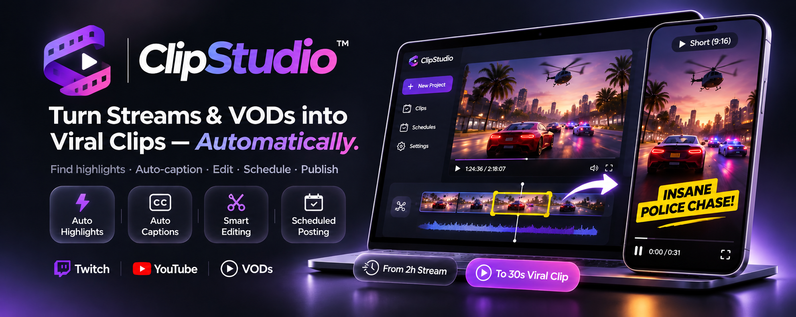
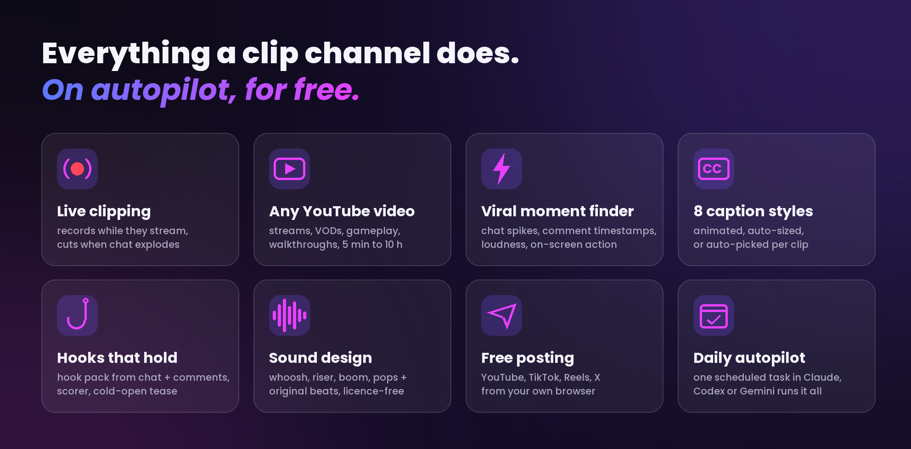
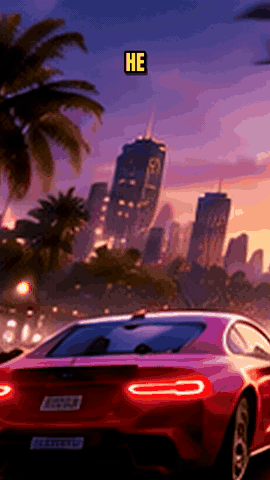
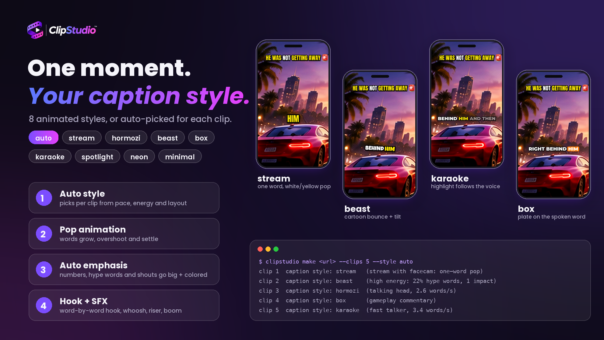
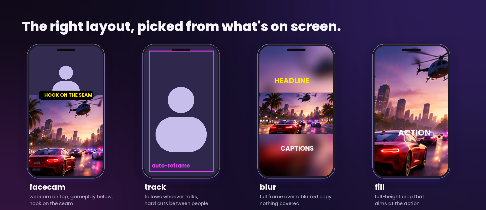
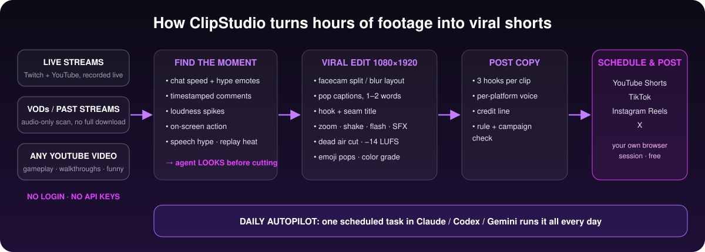

<p align="center"></p>

<p align="center">


</p>

<p align="center">
<b>Find the moments. Edit them like a top clip channel. Post them on schedule.</b><br>
Live Twitch & YouTube streams, finished VODs and any YouTube video become vertical shorts with animated captions,
hooks and sound design. Everything runs on your machine, free, as an agent skill for
<b>Claude Code · Codex · Gemini CLI · Antigravity</b>.
</p>

<p align="center"></p>

<table><tr>
<td width="30%"></td>
<td>

### Just ask your agent

> *"Use clipstudio: make 8 clips from this VOD, auto style: &lt;url&gt;"*
>
> *"Clip whoever is streaming GTA 6 right now."*
>
> *"Find this week's most-viewed GTA 6 videos and clip the best moments."*
>
> *"Set up my daily clipping at 7 pm."*

Every step is a CLI command that prints JSON, so any coding agent can drive it. The agent **looks at every
moment and every render** before anything ships.

**You decide how many clips:** 1, 5, 25, 100. The only limits are the source length and your machine.

</td></tr></table>

<p align="center"></p>

<p align="center"></p>

<p align="center"></p>

## Install

| Agent | One command |
|---|---|
| **Claude Code** | `git clone https://github.com/Harishik/clipstudio ~/.claude/skills/clipstudio && bash ~/.claude/skills/clipstudio/install.sh --deps-only` |
| **Codex** | `git clone https://github.com/Harishik/clipstudio ~/.codex/skills/clipstudio && bash ~/.codex/skills/clipstudio/install.sh --deps-only` |
| **Gemini CLI** | `gemini extensions install https://github.com/Harishik/clipstudio && bash ~/.gemini/extensions/clipstudio/install.sh --deps-only` |
| **Antigravity** | `git clone https://github.com/Harishik/clipstudio ~/.gemini/antigravity/skills/clipstudio && bash ~/.gemini/antigravity/skills/clipstudio/install.sh --deps-only` |
| **All of them** | `curl -fsSL https://raw.githubusercontent.com/Harishik/clipstudio/main/install.sh \| bash -s -- --all` |
| **Others** (Cursor, Copilot, OpenCode…) | `npx skills add Harishik/clipstudio`, then run `install.sh --deps-only` once |

Needs Python 3.10+ and ffmpeg (the installer adds ffmpeg via brew/apt/winget). Everything else is free and open source:
yt-dlp, streamlink, faster-whisper, OpenCV, Pillow, Playwright.

## What's inside

| | |
|---|---|
| 🔴 **Live, recorded and any video** | Live streams are clipped as they happen. Finished streams and *any* YouTube video (gameplay, walkthroughs, funny moments, 5 min to 10 h) can be filtered by length and recency. |
| 🔓 **No login to fetch** | Anonymous Twitch chat, YouTube's full live chat, chat replay and comments, and a built-in Twitch VOD resolver. Audio-only scanning; only the chosen seconds are cut from the source. |
| 🎯 **Viral moment finder** | Chat spikes and hype emotes, **timestamps viewers write in comments**, loudness spikes, on-screen action, speech hype. Chat-driven windows shift back to catch the moment *before* chat reacts. Intros and outros are skipped. |
| 🔤 **8 caption styles + auto** | `stream`, `hormozi`, `beast`, `box`, `karaoke`, `spotlight`, `neon`, `minimal`, or **`auto`**, which picks per clip from talking pace, energy, layout and amount of speech. Words pop in frame by frame, auto-size, key words get bigger and recolored, plus action captions and keyword emoji. `clipstudio styles` previews them all on your clip. |
| 🎬 **Edited like a clip channel** | Facecam split snapped to the overlay border, auto-reframe that follows the speaker, blur fit, smart crop. Zoom cuts with whip-blur, impact zoom/shake/warm flash. Dead air and letterbox bars are cut automatically, color graded, -14 LUFS. |
| 🪝 **Hooks that hold** | `clipstudio hooks` pulls chat and timestamped comments from that exact moment plus formulas taken from shorts with 2M–1.1B views. `hookcheck` scores hooks and titles. On-screen hooks type in word by word; persistent question hooks; `--tease` cold-opens on the payoff. |
| 🔊 **Sound design** | A licence-free synthesized SFX kit placed the way viral editors do: whoosh+hit on the hook, riser→boom on impacts, whips on zoom cuts, pops, a ding on the end card. Original phonk/trap/chill beats ducked under speech. |
| ✍️ **Post copy per platform** | YouTube titles in the patterns top clip channels use, plus TikTok, Reels, X and Facebook captions, each with the hook line, context, credit and a comment-bait question. Banned-content and campaign-rule checks. |
| 📤 **Free scheduling & posting** | Sign in once yourself in a dedicated browser profile. ClipStudio posts through YouTube Studio, TikTok Studio, Instagram and X on your time slots. No API keys, no paid tools. Approval required unless you turn on auto-post. |
| ⏰ **Daily autopilot** | `clipstudio daily` + [`prompts/daily-task.md`](prompts/daily-task.md) as a scheduled task in Claude, Codex or Gemini: live clipping, top new videos, judging, edit, post copy, queue, post. |

## CLI tour
```bash
clipstudio make <url> --clips 8 --length 30 --style auto        # one command: N clips, rendered
clipstudio streams --game "gta 6"                               # who's live (Twitch + YouTube)
clipstudio videos --query "GTA 6 funny moments" --min 5 --max 60 --days 7
clipstudio styles <job> <clip>                                  # preview all caption styles on your clip
clipstudio hooks <job> <clip> && clipstudio hookcheck "He was NOT getting away 🚨"
clipstudio render <job> <clip> --hook "..." --tease --music phonk --cta "Rate it 1-10"
clipstudio posts <job> <clip> && clipstudio check <job> <clip> && clipstudio queue <job> <clip> --platforms youtube,tiktok
clipstudio login youtube && clipstudio approve all && clipstudio publish
clipstudio live https://www.twitch.tv/<streamer> --auto-render  # clip while they stream
clipstudio daily --clips 6                                      # the daily autopilot
```

## Docs
- [SKILL.md](SKILL.md): the full workflow agents follow
- [references/editing.md](references/editing.md): layouts, caption styles, sound design, effects
- [references/hooks.md](references/hooks.md): hook formulas, post titles and captions from viral shorts
- [references/platforms.md](references/platforms.md): per-platform copy
- [references/publishing.md](references/publishing.md): free posting and scheduling in every agent
- [references/rules.md](references/rules.md): clipping basis, monetization reality, hard rules

## Honest notes
- Posting automates *your own* logged-in browser. It's free, but web UIs change (failures are exported and
  screenshotted), so keep volumes human. Personal use.
- Clip on a real basis: a campaign, the creator's permission, your own footage, or added commentary. Credit is automatic.
- Twitch blocks VOD playback in some countries (e.g. South Korea), and hides VOD chat from anonymous requests on many
  channels. Live always works. YouTube doesn't serve "most replayed" data to logged-out visitors, so timestamped
  comments take its place.

## Credits
Combines and extends three ideas:
- a GTA 6 clipping skill catalogue;
- a "watch it live, don't download" watcher (streamlink + anonymous Twitch chat + ffmpeg + Whisper);
- the "judge before you cut" lesson.

Editing conventions were studied from public viral shorts. Visuals use original ClipStudio artwork only.
MIT licence. Fonts: Anton, Montserrat, Bebas Neue, Bangers (SIL OFL), Luckiest Guy (Apache 2.0).
